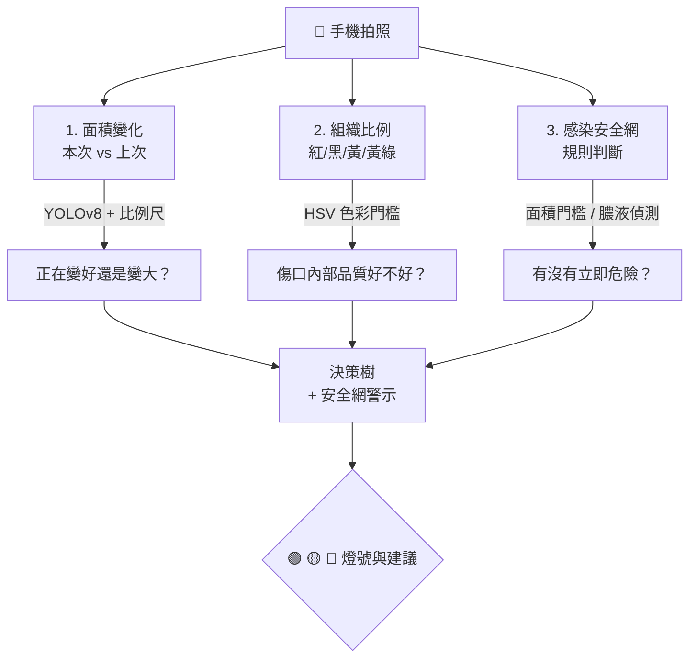
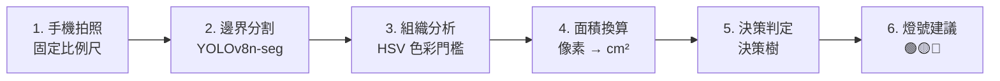
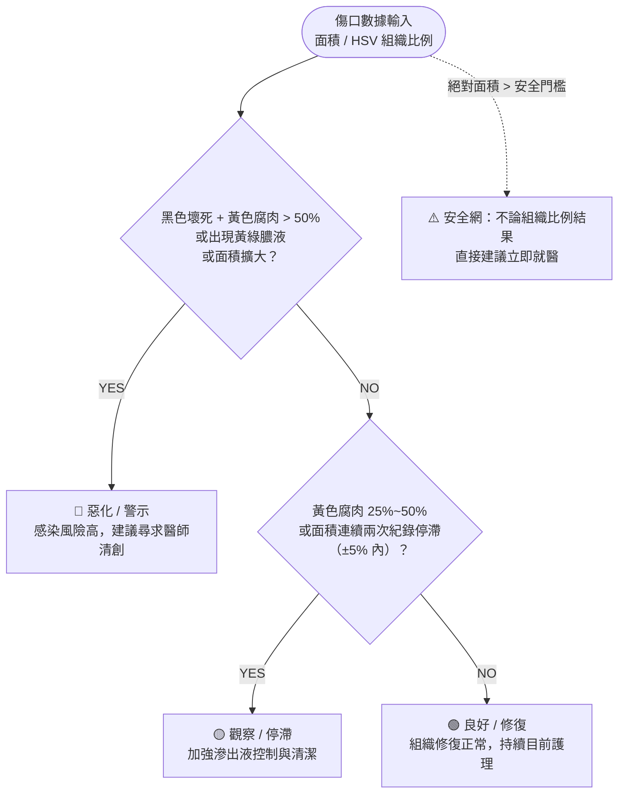
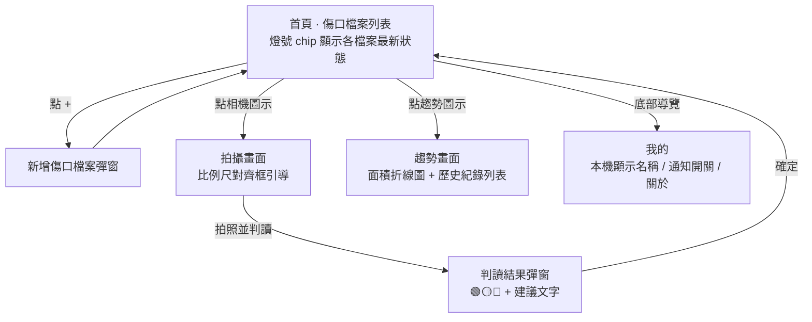

# H.E.R.A. — Healing Evaluation and Recognition Architecture

> 邊緣運算智慧傷口照護系統：用一張照片，追蹤急性外傷的癒合軌跡。

**H.E.R.A.**（Healing Evaluation and Recognition Architecture）是一套專為邊緣裝置設計的離線智慧傷口評估系統，聚焦**急性外傷**（擦傷、割傷、燙傷等居家常見的小傷口）。透過輕量化 YOLOv8n-seg 模型完成傷口邊界分割，搭配 HSV 色彩門檻進行組織品質分析，並結合面積變化趨勢與參考 PUSH Tool 概念設計的決策樹，交叉判斷傷口的癒合狀態，最終以 🟢🟡🔴 燈號給出護理或就醫建議 —— 全程手機端離線運算，無需上傳雲端。

> **適用範圍與免責聲明**
> - 本系統聚焦急性外傷，**不評估**糖尿病足潰瘍、壓瘡等慢性傷口。
> - 僅提供輔助性觀察與提醒，**不是醫療診斷**，也不取代專業醫療人員的判斷。

---

## 目錄

- [核心概念](#核心概念)
- [系統架構](#系統架構)
- [技術棧](#技術棧)
- [資料集](#資料集)
- [癒合判定決策樹](#癒合判定決策樹)
- [App 畫面流程與實作狀態](#app-畫面流程與實作狀態)
- [效能目標](#效能目標)
- [開發紀錄](#開發紀錄)
- [限制與後續方向](#限制與後續方向)

---

## 核心概念

癒合情況不是單一數字，而是「面積趨勢」＋「組織品質」＋「感染風險」三者交叉判斷。

1. **面積變化**：本次傷口面積 vs 上次紀錄（YOLOv8 分割 + 比例尺換算 cm²）
2. **組織比例**：紅／黑／黃／黃綠色像素佔比（HSV 色彩門檻，非 AI 運算）
3. **感染安全網**：目前以規則判斷（絕對面積超過門檻，或偵測到黃綠膿液即觸發），判讀結果會顯示觸發原因

---

## 系統架構

六步驟資料流：

> **關鍵設計**：AI 只負責「找到傷口邊界」；組織顏色比例用傳統影像處理（HSV）計算，大幅降低手機運算負擔。
>
> **為什麼可行**：HSV 色彩分析是純數學運算（毫秒級），真正吃算力的只有「找傷口邊界」——單類別分割比五類別組織分割輕量許多，非常適合手機離線執行。

---

## 技術棧

> ⚠️ **與原始規劃的差異**：App 開發實際採用 **Flutter**（跨平台單一程式碼庫），
> 而非最初規劃的 Kotlin/Swift 原生雙平台開發，因團隊人力考量調整。

| 模組 | 技術 |
| --- | --- |
| 邊界分割模型 | YOLOv8n-seg (Ultralytics) |
| 模型輕量化 | INT8 量化、TFLite (Android) / Core ML (iOS) |
| 組織分析 | HSV 色彩門檻（純 Dart 運算，不需要 OpenCV） |
| 決策邏輯 | Rule-based Logic，參考 PUSH Tool 設計 |
| App 開發 | **Flutter**（`camera` + `ultralytics_yolo` 套件） |
| 本地儲存 | SQLite（Flutter 端透過 `sqflite`） |
| 測試 | `flutter test`（決策邏輯 10 個案例 + 1 個 smoke test） |
| 訓練環境 | Google Colab GPU |

> ⚠️ **模型現況**：`assets/models/` 目前為空，YOLOv8n-seg 模型**尚未訓練**、尚未整合。
> App 的 `_analyzeImage()` 暫以示範資料運作，判讀結果彈窗會標示「⚠️ 示範資料」，
> 真實模型接上後會自動切換。
>
> ⚠️ **感染安全網現況**：目前**尚未訓練**獨立的感染分類器，以規則判斷暫代
> （絕對面積 > 門檻值，或偵測到黃綠膿液即觸發）。是否訓練獨立分類器待評估。

---

## 資料集

> **專案定位已確定為急性外傷。** 早期規劃曾列出幾個足潰瘍公開資料集（DFUC 2022、FUSeg 2021、DFUC 2021），
> 那是初期構想，**目前並未用於訓練**，模型也尚未開始訓練。後續訓練資料以急性外傷影像為主。

| 資料 | 內容 | 狀態 |
| --- | --- | --- |
| 急性外傷影像 | 擦傷、割傷、燙傷等居家常見小傷口，含傷口邊界標註，用於訓練邊界分割模型 | 待收集與標註 |
| 同一傷口的連續紀錄 | 同一傷口多次拍攝，用於驗證「連續趨勢」判斷與決策門檻 | 待收集 |
| 公開資料集 | 早期規劃的足潰瘍資料集（慢性傷口） | 目前未用於訓練；日後若要引用任何公開資料集，須先確認領域是否適用及授權條款 |

資料切分原則：訓練 60% / 驗證 20% / 測試 20%，確保同一人的影像不跨集合洩漏。

> 收集急性外傷影像時，需取得當事人同意並妥善保護個資。

---

## 癒合判定決策樹

整合面積數字 + 組織比例，帶入參考 PUSH Tool 概念設計的決策規則：

| 燈號 | 判定條件 | 行動建議 |
| --- | --- | --- |
| 🟢 良好 (Healing) | 紅色肉芽 + 粉紅上皮 > 75% 且面積比上次縮小 > 10% | 組織修復正常，持續目前護理 |
| 🟡 觀察 (Stagnant) | 黃色腐肉 25%~50% 或面積**連續兩次紀錄**停滯（±5% 內） | 復原停滯，加強滲出液控制與清潔 |
| 🔴 惡化 (Deteriorating) | 黑色壞死 + 黃色腐肉 > 50% 或出現黃綠膿液 / 面積擴大 | 感染風險高，建議尋求醫師清創 |

**安全網規則**：不論組織比例結果如何，若傷口絕對面積 > 設定門檻值，直接跳出「建議立即就醫」——保守但安全。

> ⚠️ **規則適用性**：PUSH Tool 是美國壓瘡諮詢委員會（NPUAP）為壓瘡設計的量表，
> 後續研究也將其用於靜脈潰瘍與糖尿病足潰瘍；目前**沒有針對急性外傷的驗證**。
> 急性外傷的癒合時程較短、組織型態也不同，上述門檻（50% / 25% / ±5%）都是自行設計的初始值，
> 需要用急性外傷資料重新調整與驗證。「停滯」目前以「連續兩次紀錄」判斷，不以週為單位。

---

## App 畫面流程與實作狀態

> 目前為灰階線框稿，配色尚未定案；結構已對應 Flutter 端實際開發進度。

| 畫面 | 說明 | 實作狀態 |
| --- | --- | --- |
| 首頁（傷口檔案列表） | 卡片式列表，每筆顯示最新燈號、建立日期，右側可直接跳轉拍攝或趨勢 | ✅ 已完成，燈號讀取自本機資料庫最新紀錄 |
| 新增傷口檔案彈窗 | 輸入名稱後建立一筆新的追蹤檔案 | ✅ 已完成 |
| 拍攝畫面 | 相機預覽 + 比例尺對齊虛線框（四角醫療綠標記）+ 拍照按鈕 | ✅ 相機串接完成；無相機的裝置會顯示「模擬拍照並判讀（測試用）」；比例尺辨識**尚未實作**，框線僅為視覺引導 |
| 判讀結果彈窗 | 燈號圖示 + 建議文字；顯示安全網觸發原因（面積門檻 / 膿液偵測）與實際數據；模型未接上時顯示「⚠️ 示範資料」標籤 | ✅ 已完成優雅降級機制，真實模型接上後自動切換 |
| 趨勢畫面 | 面積折線圖（X 軸為日期、Y 軸為整齊刻度）+ 歷史紀錄清單（面積、日期、燈號、照片縮圖） | ✅ 已完成；照片檔案不存在時顯示佔位圖示 |
| 我的（設定頁） | 本機顯示名稱、就醫提醒推播開關、關於本專案的免責聲明 | ⚠️ 顯示名稱/開關已可儲存，但推播尚未接上實際觸發邏輯 |

---

## 效能目標

| 版本 | 模型大小 | 單張推論時間（估） | 適用情境 |
| --- | --- | --- | --- |
| YOLOv8n-seg（FP32 原始） | ~7 MB | 800ms – 1.5s | 開發測試 / 雲端備援 |
| YOLOv8n-seg（INT8 量化） | ~2 MB | 200 – 500ms | 手機端離線即時使用 |

目標：在中階手機（如 Snapdragon 6 系列等級）單張推論 < 500ms。以上為預估值，模型尚未整合，尚未實測。

---

## 開發紀錄

依 commit 紀錄整理：

- **2026-08-23**：新增 Flutter App 專案程式碼；套件名稱改為 `hera`。
- **2026-08-24**：判讀結果彈窗顯示安全網觸發原因。
- **2026-08-30**：補齊「面積連續兩次停滯」判斷邏輯並新增單元測試；修正趨勢圖座標軸顯示、新增照片縮圖與無相機測試支援；升級 `camera` 套件以修復 CameraX 編譯相容性問題。

後續進度改以 GitHub Issues / Projects 追蹤。

---

## 限制與後續方向

- **訓練資料尚未收集**：模型尚未訓練，急性外傷影像需要收集、標註與驗證（見[資料集](#資料集)）。
- **決策規則待驗證**：規則參考 PUSH Tool 概念自行設計，非官方量表，門檻值（50% / 25% / ±5%）待用急性外傷資料驗證；後續可與醫療單位合作校準。
- **模型尚未訓練、未整合**：App 目前走示範資料。
- **HSV 色彩門檻為粗略估計**：需要標註過的實際傷口照片才能校正。
- **不同手機相機的色差**：同一傷口在不同手機拍出的顏色可能不同，目前沒有色彩校正機制，列為後續評估項目。
- **感染安全網**：目前是規則判斷暫代，是否訓練獨立分類器待評估。
- **跨次追蹤資料稀缺**：同一傷口多次紀錄的資料不易取得，現階段以測試資料模擬展示。
- **測試覆蓋**：目前只有決策邏輯與一個 smoke test，面積換算服務（`AreaCalculationService`）尚未有單元測試。
- **規劃中的新功能（URS v2，尚未開發）**：
  - **擦藥提醒**：每個傷口自訂每日擦藥時間與次數，以本機通知提醒，並可記錄「已完成擦藥」與查詢紀錄（預計以 `flutter_local_notifications` 實作；iOS 本機排程保留上限為 64 筆）。
  - **傷口歷程 PDF 報告**：單一傷口的照片、拍攝時間、面積、燈號與趨勢圖，在手機端自動整理成 PDF（預計以 `pdf` 套件實作）。
  - **報告 QR Code 分享**：讓醫師掃描後以自己的裝置檢視。需要雲端與分享權限設計，且涉及敏感健康資料與隱私評估，列為第二階段，尚在評估。
  - **3D 人體模型傷口定位與管理**：以人體模型選擇受傷部位、顯示傷口標記、管理多個傷口；技術與模型授權待評估，可先以 2D 人形圖驗證流程。
- **其他尚未開發的延伸功能**：就醫提醒推播的實際觸發邏輯、App 端護理紀錄整合、家屬共享檢視、拍照品質即時檢測、模型信心度顯示。
- **帳號與雲端同步**：評估中，目前所有資料僅存在本機（QR Code 分享若實作，也需要雲端）。
