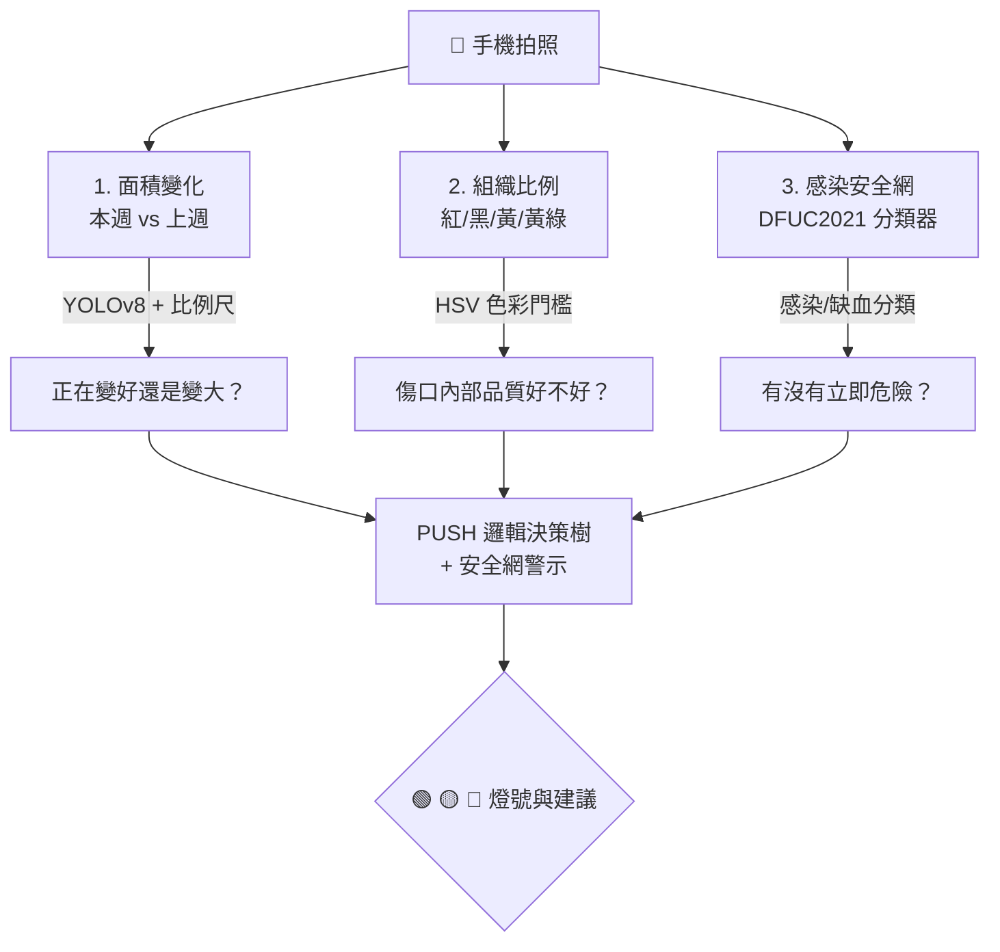
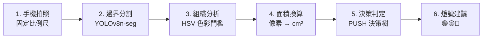
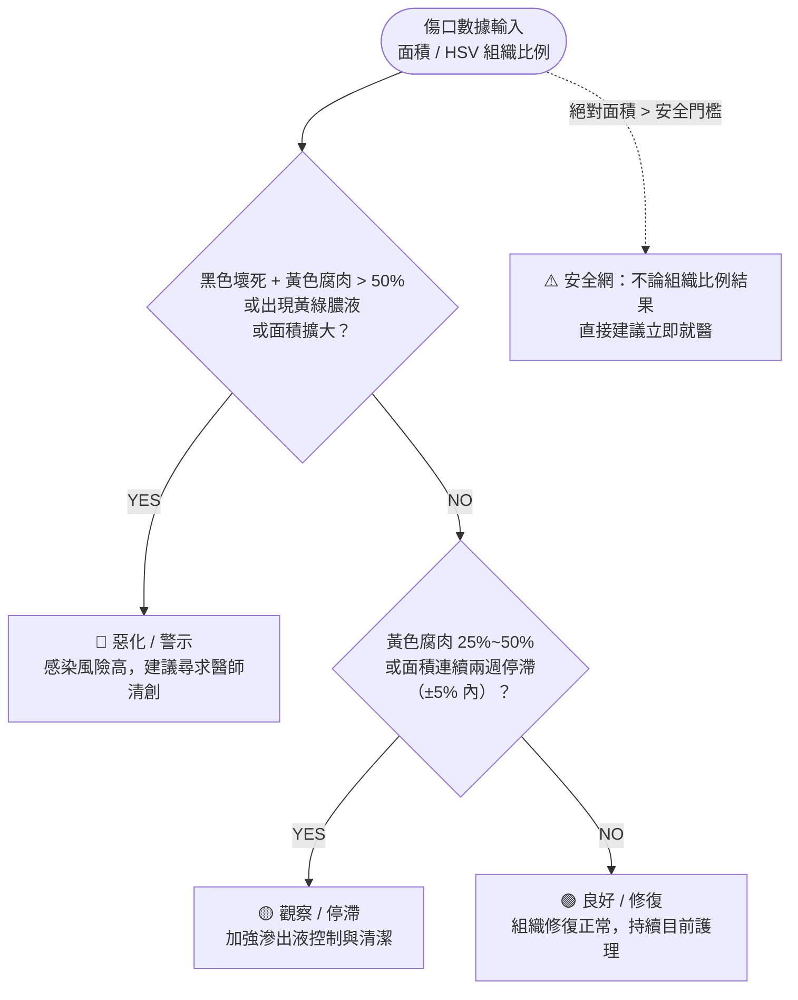
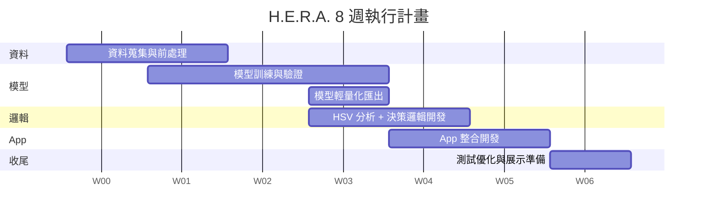

# H.E.R.A. — Healing Evaluation and Recognition Architecture

> 邊緣運算智慧傷口照護系統：用一張照片，讀懂傷口的癒合軌跡。

**H.E.R.A.**（Healing Evaluation and Recognition Architecture）是一套專為邊緣裝置設計的離線智慧傷口評估系統。透過輕量化 YOLOv8n-seg 模型完成傷口邊界分割，搭配 HSV 色彩門檻進行組織品質分析，並結合面積變化趨勢與參考 PUSH Tool 概念設計的決策樹，交叉判斷傷口的癒合狀態，最終以 🟢🟡🔴 燈號給出護理或就醫建議 —— 全程手機端離線運算，無需上傳雲端。

---

## 目錄

- [核心概念](#核心概念)
- [系統架構](#系統架構)
- [技術棧](#技術棧)
- [資料集](#資料集)
- [癒合判定決策樹](#癒合判定決策樹)
- [效能表現](#效能表現)
- [專案時程](#專案時程)
- [限制與後續方向](#限制與後續方向)

---

## 核心概念

癒合情況不是單一數字，而是「面積趨勢」＋「組織品質」＋「感染風險」三者交叉判斷。

1. **面積變化**：本週傷口面積 vs 上週（YOLOv8 分割 + 比例尺換算 cm²）
2. **組織比例**：紅／黑／黃／黃綠色像素佔比（HSV 色彩門檻，非 AI 運算）
3. **感染安全網**：感染／缺血分類器（DFUC2021 醫療標註訓練）

---

## 系統架構

六步驟資料流：

> **關鍵設計**：AI 只負責「找到傷口邊界」；組織顏色比例用傳統影像處理（HSV）計算，大幅降低手機運算負擔。
>
> **為什麼可行**：HSV 色彩分析是純數學運算（毫秒級），真正吃算力的只有「找傷口邊界」——單類別分割比五類別組織分割輕量許多，非常適合手機離線執行。

---

## 技術棧

| 模組 | 技術 |
| :--- | :--- |
| 邊界分割模型 | YOLOv8n-seg (Ultralytics) |
| 模型輕量化 | INT8 量化、TFLite (Android) / Core ML (iOS) |
| 組織分析 | OpenCV、HSV 色彩門檻 |
| 決策邏輯 | Rule-based Logic，參考 PUSH Tool 設計 |
| App 開發 | Kotlin + CameraX（Android）／ Swift + AVFoundation（iOS） |
| 本地儲存 | SQLite / Room |
| 訓練環境 | Google Colab GPU |

---

## 資料集

| 資料集 | 內容 | 用途 |
| :--- | :--- | :--- |
| **DFUC 2022** | 4,000 張，5 位足科醫師以 VGG Annotator 標註的傷口邊界 polygon mask | 訓練邊界分割模型 |
| **DFUC 2021** | 醫療專業人員標註的感染 / 缺血分類標籤，共 1,703+ 例 | 訓練感染安全網分類器 |
| **FUSeg 2021** | 1,210 張足潰瘍影像，512×512，附分割 mask | 擴充邊界分割訓練集，提高泛化能力 |

資料切分：訓練 60% / 驗證 20% / 測試 20%，確保同病患影像不跨集合洩漏。

---

## 癒合判定決策樹

整合面積數字 + 組織比例，帶入參考 PUSH Tool 概念設計的決策規則：

| 燈號 | 判定條件 | 行動建議 |
| :--- | :--- | :--- |
| 🟢 良好 (Healing) | 紅色肉芽 + 粉紅上皮 > 75% 且面積比上週縮小 > 10% | 組織修復正常，持續目前護理 |
| 🟡 觀察 (Stagnant) | 黃色腐肉 25%~50% 或面積連續兩週停滯（±5% 內） | 復原停滯，加強滲出液控制與清潔 |
| 🔴 惡化 (Deteriorating) | 黑色壞死 + 黃色腐肉 > 50% 或出現黃綠膿液 / 面積擴大 | 感染風險高，建議尋求醫師清創 |

**安全網規則**：不論組織比例結果如何，若傷口絕對面積 > 設定門檻值，直接跳出「建議立即就醫」——保守但安全。

---

## 效能表現

| 版本 | 模型大小 | 單張推論時間（估） | 適用情境 |
| :--- | :--- | :--- | :--- |
| YOLOv8n-seg（FP32 原始） | ~7 MB | 800ms – 1.5s | 開發測試 / 雲端備援 |
| YOLOv8n-seg（INT8 量化） | ~2 MB | 200 – 500ms | 手機端離線即時使用 |

目標：在中階手機（如 Snapdragon 6 系列等級）單張推論 < 500ms。

---

## 專案時程

---

## 限制與後續方向

- 目前決策規則為參考 PUSH Tool 概念自行設計，非官方量表，門檻值（50% / 25% / ±5%）待進一步驗證。
- 跨週追蹤資料（同病患多次回診）較稀缺，現階段以測試資料模擬展示。
- 後續可與醫療單位合作校準門檻值，進一步提升臨床可信度與安全性。

---

## License

MIT License（依實際專案需求調整）
